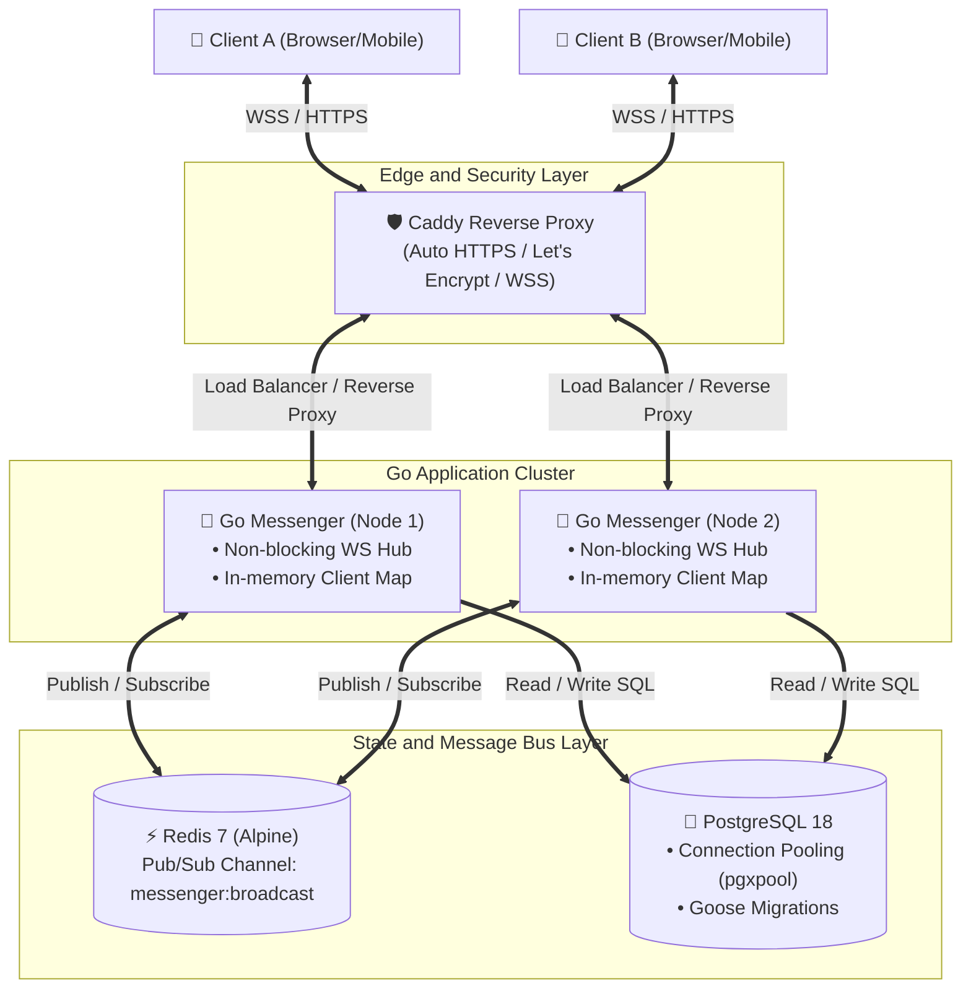

# Real-Time Distributed Messenger

[](https://github.com/didok362/messenger/actions/workflows/ci.yml)
[](https://golang.org)
[](https://www.docker.com)
[](https://github.com/didok362/messenger)
[](https://leclochard.duckdns.org)
[](https://opensource.org/licenses/MIT)

A scalable, high-throughput real-time messaging platform built in Go. Designed with clean architecture, horizontal scaling capabilities via Redis Pub/Sub, non-blocking WebSocket concurrency, automated Let's Encrypt TLS termination, and a comprehensive CI/CD test suite.

🌐 **Live Production Demo**: [https://leclochard.duckdns.org](https://leclochard.duckdns.org)

---

## 🏗 System Architecture



---

## ⚡ Key Engineering Highlights

### 1. Horizontal WebSocket Scaling (Redis Pub/Sub)
* **The Problem**: In standard single-node architectures, WebSocket connections reside exclusively in server memory (`map[uuid]*Client`). When scaling horizontally across multiple container instances, clients connected to different nodes cannot communicate directly.
* **The Solution**: Integrated a distributed messaging bus powered by **Redis Pub/Sub** (`messenger:broadcast`). When a user sends a message, Node A dispatches an event to the Redis bus in sub-millisecond time. All active nodes receive the broadcast and push it to their locally connected WebSocket subscribers.
* **Graceful Fallback**: If Redis is offline or unavailable (e.g. running standalone in lightweight dev environments), the Hub automatically falls back to in-memory dispatch channels without dropping local connections.

### 2. Zero-Blocking WebSocket Hub
* **Decoupled Architecture**: Database queries (`GetChatMemberIDs`, message persistence) were eliminated from the central WebSocket event loop (`Hub.Run`).
* **Non-blocking Event Loops**: Heavy I/O is handled upstream in the service layer (`ChatService`). The Hub solely handles non-blocking pointer routing over in-memory channels with read/write mutex protection (`sync.RWMutex`), preventing head-of-line blocking and connection starvation under high concurrency.

### 3. Concurrency Safety & Race Condition Verification
* **ThreadSanitizer Validated**: All core business logic and concurrency primitives are routinely verified using Go's race detector (`go test -race`).
* **Clean Separation of Concerns**: Repository layer, service domain models, HTTP transport, and WebSocket handlers adhere to idiomatic Go project layout principles.

### 4. Automated Production Infrastructure
* **Zero-Touch HTTPS**: Integrated **Caddy** as a containerized edge proxy, handling automated Let's Encrypt TLS certificate provisioning and reverse proxying WSS connections without manual certbot scripting.
* **CI/CD Pipeline**: GitHub Actions pipeline validating code cleanliness (`go vet`), unit test suite with race detection (`go test -v -race -cover`), binary compilation, and multi-stage Docker builds on every commit.

---

## 🛠 Tech Stack

| Component | Technology | Description |
| :--- | :--- | :--- |
| **Language** | Go 1.24 | High-performance compiled systems language |
| **Real-Time** | Gorilla WebSocket | Full-duplex bidirectional client communication |
| **Message Broker**| Redis 7 (Alpine) | Sub-millisecond Pub/Sub for multi-node broadcast |
| **Database** | PostgreSQL 18 | Relational persistence with connection pooling (`pgxpool`) |
| **Migrations** | Goose | Versioned, reproducible SQL schema migrations |
| **Security** | JWT & Bcrypt | Stateless token auth + salted adaptive password hashing |
| **Edge Proxy** | Caddy Server | Automated TLS/SSL termination & reverse proxy |
| **Containers** | Docker & Compose | Reproducible multi-service deployment |
| **CI/CD** | GitHub Actions | Automated build, test, and container validation |

---

## 🚀 Getting Started

### Prerequisites
* [Docker](https://docs.docker.com/get-docker/) & [Docker Compose](https://docs.docker.com/compose/)
* [Go 1.24+](https://golang.org/dl/) (for local native development)

### Quickstart with Docker Compose

1. **Clone the repository**:
   ```bash
   git clone https://github.com/didok362/messenger.git
   cd messenger
   ```

2. **Configure environment variables**:
   Create a `.env` file in the root directory:
   ```env
   HTTP_PORT=8080
   POSTGRES_USER=postgres
   POSTGRES_PASSWORD=postgres
   POSTGRES_DB=messenger
   JWT_SECRET=your-super-secret-key
   JWT_TTL=24h
   REDIS_HOST=redis
   REDIS_PORT=6379
   ```

3. **Start all services**:
   ```bash
   docker compose up -d --build
   ```

4. **Apply database migrations**:
   ```bash
   make migrate-up
   ```
   Open your browser at `http://localhost:8080`.

---

## 🧪 Testing & Code Quality

The project enforces strict unit testing covering authentication, session lifecycle, direct messaging, group chat authorization, and broadcast fan-out.

To run the complete test suite with **race condition detection** and **coverage reports**:

```bash
make test
```

Expected output:
```text
=== RUN   TestAuthService_Register
--- PASS: TestAuthService_Register
=== RUN   TestAuthService_Login
--- PASS: TestAuthService_Login
=== RUN   TestChatService_CreateDirectChat
--- PASS: TestChatService_CreateDirectChat
=== RUN   TestChatService_SendMessage
--- PASS: TestChatService_SendMessage
=== RUN   TestChatService_MarkChatAsRead
--- PASS: TestChatService_MarkChatAsRead
=== RUN   TestChatService_CreateGroupChat
--- PASS: TestChatService_CreateGroupChat
=== RUN   TestChatService_GetChatMessages
--- PASS: TestChatService_GetChatMessages
PASS
coverage: 70.0% of statements
ok      github.com/didok362/messenger/internal/service
```

---

## 📦 Makefile Reference

| Command | Action |
| :--- | :--- |
| `make run` | Run server locally with native Go tooling |
| `make test` | Run all unit tests with `-race` and coverage calculation |
| `make deploy` | Pull latest branch and trigger production compose rebuild |
| `make migrate-up` | Run pending database migrations via Goose |
| `make migrate-down` | Rollback last database migration |
| `make migrate-status` | Display current database migration status |

---

## 📄 License

This project is licensed under the [MIT License](LICENSE).
